# Paykit × WDK example wallet

A React Native example wallet that shows how [Tether WDK](https://wdk.tether.io/)
and [Pubky Paykit](https://github.com/pubky/paykit-rs) work together:

- **WDK** holds the keys and moves the money (testnet only).
- **Paykit** turns Pubky identities into payable contacts: public and private
  payment endpoints, payment requests and more.

> **Testnet only. Not production software.** This repository is a reference for
> developers. Keys are stored with simple demo-grade protection.

## Status

**Complete as a testnet reference.** All six phases in
[`docs/PLAN.md`](docs/PLAN.md) are built: the wallet (WDK), identities and
public payments, contacts and private payments, payment requests with
proofs and receipts, and the stretch features (automatic payments, block
and forget, backup and restore). Phase 6 added the polish: Welcome copy
and illustration, a message per sign-up failure, screenshots blocked
while a recovery phrase or backup is on screen, MMKV files kept out of
iOS backups, quiet recovery from dropped Electrum connections, and
release builds for both platforms. [`docs/DEMO.md`](docs/DEMO.md) is a
step-by-step two-phone demo of every feature.

Checked on both simulators in Phase 6: the release builds install over
the dev clients and keep their data (same signing certificate on
Android), start straight into the saved identities with the two phones
still linked, and their bundles hold no demo phrase or invite code;
Android's window carries `FLAG_SECURE` while a backup is held and the
screenshot comes out black; on iOS, `Documents/mmkv` carries the
backup-exclusion attribute.

**Real testnet money moved both ways, in both assets, on every payment
path in the demo.** [`docs/DEMO-RUN.md`](docs/DEMO-RUN.md) records the
run of 27 October 2026, with a link to every transaction. It covered
paying by address, paying a stranger by pubky (public endpoints),
private payments to a contact, Collect, the in-app USD₮ mint, one-time
requests in both assets with proofs, on-chain checks and receipts, a
recurring request paid by hand, and automatic payments under an
Allowance, up to its amount and hourly limits. Closing the app
mid-payment (the payer after the broadcast or during the send, the
payee before its check) still ended with one transaction and a receipt.
All 28 transactions were checked on the explorers. The run and a review
of its fixes found 10 bugs, all fixed. None sent money twice or to the
wrong place: Collect left uncollectable dust behind, and the rest were
in what the screens showed.

Honest gaps:

- **Not run with money:** marking a replaced Sepolia send as Failed. The
  app never replaces a transaction, so a unit test covers it. The
  Allowance used in the run is ended: set it up again before demoing
  DEMO step 9.
- **Restoring a backup in onboarding** has not run on a device: it needs
  a phone with no state for the identity. The same SDK restore ran in
  "Check a copied backup" on both phones. What a restore means for
  automatic payments (restored requests paid by hand, automatic payments
  paused until you resume them; see ARCHITECTURE.md, "Backup and
  restore") is covered by unit tests and code review only.
- **iOS screenshot blocking** could not be checked on the simulator,
  whose screenshots read the framebuffer directly. Android's
  `FLAG_SECURE` was checked.
- Not used: Paykit key rotation (`rotatePaykitIdentityKey`), Allowance
  reassociation, shared-state storage, a self-serve invite code. Trusted
  time is the phone clock. Android 12+ device-to-device transfer is not
  blocked (the files are unreadable without the Keystore key).

Each phase's notes, and what was checked on the simulators, are in
[`docs/ARCHITECTURE.md`](docs/ARCHITECTURE.md).

## How the two libraries meet

**WDK holds the keys and moves the money.** It runs in a separate Bare
JavaScript runtime (a worklet), derives the Bitcoin and Ethereum accounts
from the recovery phrase, quotes fees, signs and broadcasts, and reads
balances and history. **Paykit decides who, where and why.** It turns a
Pubky key into a person you can pay: their public and private payment
endpoints, the Encrypted Link between two wallets, payment requests,
proofs, receipts and Allowances. It never touches a private key for
money and never broadcasts anything.

The seam between them is small and explicit:

- **The payment adapter** (`src/paykit/paymentAdapter.ts`). Paykit asks
  the wallet, through synchronous callbacks, which addresses to publish
  or share with a contact, and checks endpoints it resolved. The answers
  come from
- **the address cache** (`src/paykit/addressCache.ts`), which
  `PaykitProvider` fills from WDK ahead of time: account 0's addresses,
  and one Bitcoin account per contact. Paykit's callbacks can't wait for
  WDK's asynchronous worklet, so the cache is what makes them possible.
- **The payment chain** (`src/features/requests/PaymentChainBridge.tsx`)
  goes the other way: Paykit's request flow hands WDK a locked amount and
  address to send, then asks WDK to read the transaction back (and, for
  USD₮, to sign the EIP-712 proof) so it can prove or verify a payment.

Both identities come from one recovery phrase: WDK derives the chain
keys, and Paykit's `pubkySecretKeyFromBip39Mnemonic` derives the Pubky
key. That is the Bitkit and Pubky Ring convention, and it is testnet-only
here because the keys are not domain-separated.

## Features and where to see them

| Library | Feature | Where in the app | Source |
|---|---|---|---|
| WDK | Create or restore a wallet from a recovery phrase | Onboarding > Your wallet | `src/features/onboarding/CreateOrRestoreScreen.tsx`, `src/wallet/useWalletLifecycle.ts` |
| WDK | Balances: Bitcoin, USD₮ and ETH for gas | Wallet tab | `src/features/wallet/WalletScreen.tsx`, `src/wallet/useWalletBalances.ts` |
| WDK | Receive: address and QR code | Wallet > Receive | `src/features/wallet/ReceiveScreen.tsx`, `src/features/wallet/receive/ReceiveCard.tsx` |
| WDK | Send with a fee quote | Wallet > Send | `src/features/wallet/SendScreen.tsx`, `src/features/wallet/send/SendReview.tsx`, `src/wallet/useSend.ts` |
| WDK | Transaction history | Wallet activity, Activity detail | `src/wallet/useActivity.ts`, `src/features/wallet/activity/ActivityRow.tsx` |
| WDK | Mint test USD₮ (Aave faucet) | You > Test funds | `src/features/wallet/GetTestUsdtButton.tsx`, `src/wallet/useUsdtFaucet.ts` |
| WDK | One Bitcoin account per contact, and Collect | Person > Bitcoin from …, You > Bitcoin from contacts | `src/features/you/ContactAccountsSection.tsx`, `src/wallet/useBtcContactAccount.ts` |
| WDK | Recovery phrase | You > Recovery phrase | `src/features/you/RecoveryPhraseSection.tsx` |
| WDK | Sign an EIP-712 proof, read a transaction to verify one | Request page | `src/wallet/usePaymentChecks.ts`, `src/wallet/erc20PaymentProof.ts` |
| Paykit | Identity from the phrase, sign up or sign in, saved session | Onboarding > Your identity | `src/features/onboarding/InviteCodeScreen.tsx`, `src/paykit/session.ts` |
| Paykit | App registry and Noise key authorization | Onboarding; You > Network details | `src/paykit/PaykitService.ts` (`setUpIdentity`), `src/paykit/networkDetails.ts` |
| Paykit | Profile: name and photo | You > Edit profile, every seal | `src/features/you/EditProfileScreen.tsx`, `src/paykit/profiles.ts` |
| Paykit | Public payment endpoints | You > What you publish | `src/features/you/PublicEndpointsSection.tsx`, `src/paykit/endpoints.ts` |
| Paykit | Pay anyone by pubky | Send > A person (pubky) | `src/features/wallet/send/PubkyRecipientField.tsx`, `src/paykit/publicPayments.ts` |
| Paykit | Contacts and the Encrypted Link handshake | People > Add, Person page | `src/features/people/AddPersonScreen.tsx`, `src/features/people/PersonScreen.tsx`, `src/paykit/syncLoop.ts` |
| Paykit | Private Payment Lists | Person > What they accept | `src/features/people/person/WhatTheyAccept.tsx`, `src/paykit/privatePayments.ts` |
| Paykit | Pay a contact privately | Person > Pay | `src/paykit/privatePayments.ts`, `src/paykit/paymentAdapter.ts`, `src/paykit/addressCache.ts` |
| Paykit | Payment requests | Requests tab, Request money, request page | `src/features/requests/RequestMoneyScreen.tsx`, `src/features/requests/RequestDetailScreen.tsx`, `src/paykit/requests.ts` |
| Paykit | Recurring requests | Request money > Every minute | `src/features/requests/RecurringPayments.tsx`, `src/paykit/recurrence.ts` |
| Paykit | Payment ledger: never pay twice | Pay request | `src/paykit/requests.ts`, `src/paykit/requestBook.ts` |
| Paykit | Proofs, verification and receipts | Request timeline, Activity detail | `src/paykit/paymentProofs.ts`, `src/paykit/requestRounds.ts`, `src/features/wallet/activity/ActivityPaykitLinks.tsx` |
| Paykit | Allowances: automatic payments | Person > Automatic payments | `src/features/people/AutomaticPaymentsScreen.tsx`, `src/paykit/allowances.ts`, `src/paykit/allowanceTerms.ts`, `src/paykit/automaticPayments.ts` |
| Paykit | Block, unblock, forget | Person page | `src/features/people/person/PersonActions.tsx`, `src/paykit/PaykitService.ts` |
| Paykit | Backup and restore | You > Contacts and requests backup; onboarding sign-in | `src/features/you/BackupSection.tsx`, `src/paykit/backup.ts`, `src/paykit/backupCrypto.ts`, `src/paykit/restoreReview.ts` |
| Paykit | Recovery markers, revisions, the sync loop | You > Network details, Sync status | `src/features/you/NetworkDetailsSection.tsx`, `src/paykit/networkDetails.ts`, `src/paykit/backup.ts` (`readBackupStatus`), `src/paykit/syncLoop.ts`, `src/paykit/eventLog.ts` |

## Screenshots

From the funded run ([`docs/DEMO-RUN.md`](docs/DEMO-RUN.md)), with real
testnet money:

| | | |
|---|---|---|
| 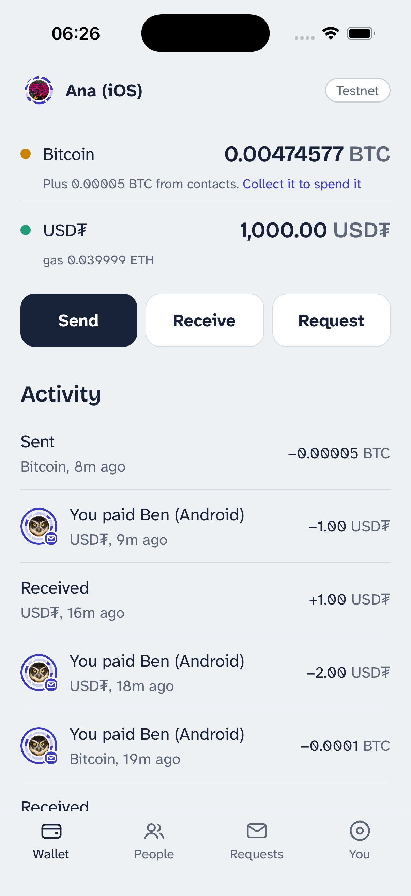 | 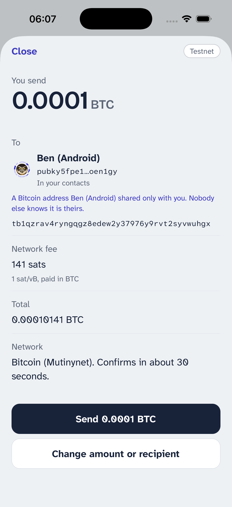 | 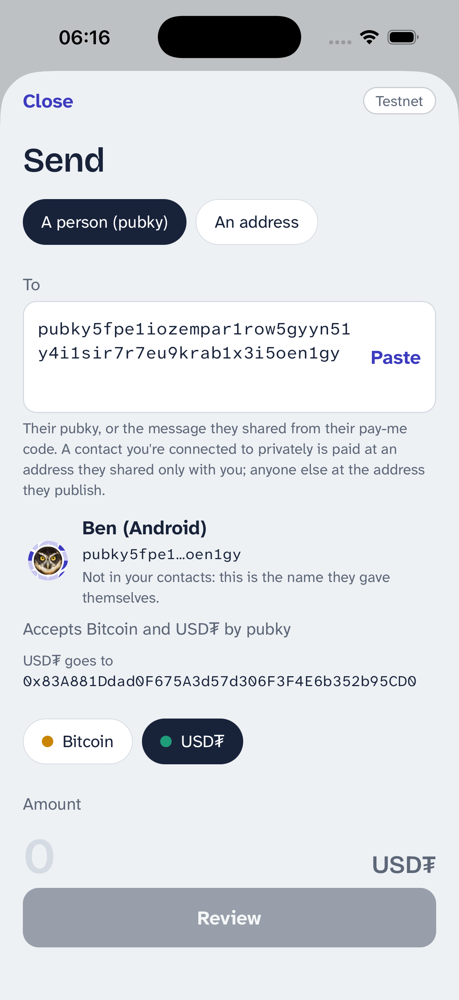 |
| Wallet and Activity | Paying a contact privately | Paying a stranger by pubky |
| 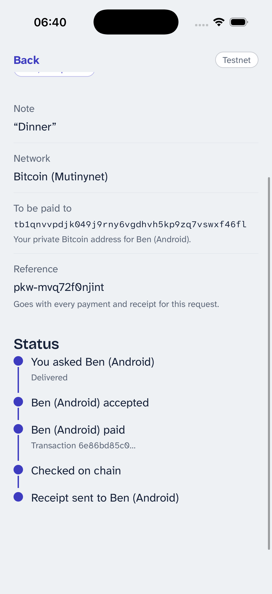 | 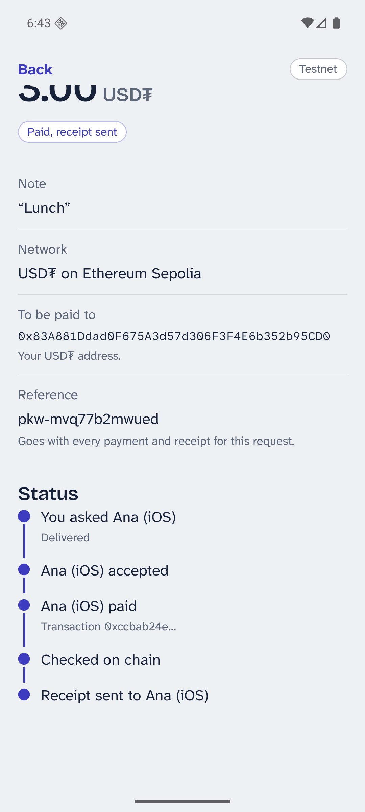 | 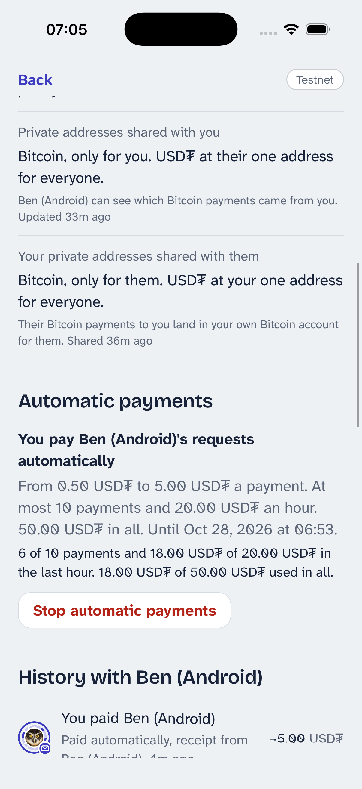 |
| A Bitcoin request, to the receipt | A USD₮ request (Android) | Automatic payments in use |

From the phases:

| | | |
|---|---|---|
| 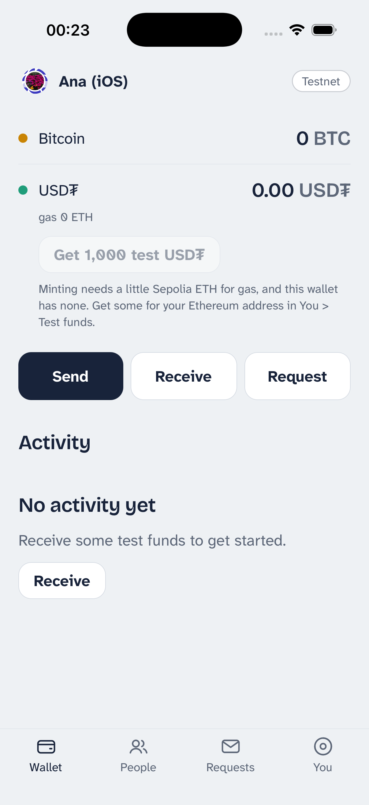 | 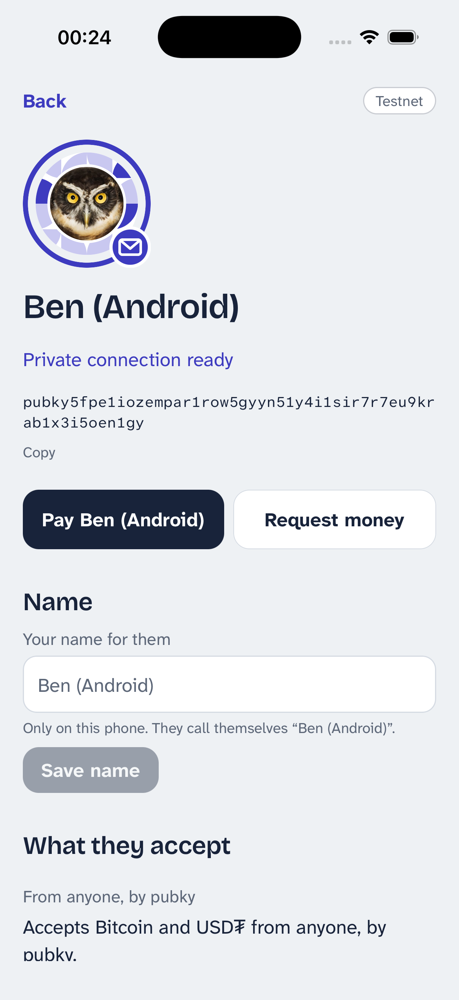 | 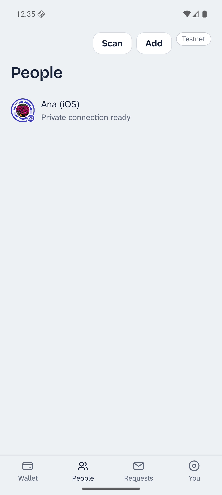 |
| Wallet (iOS release build) | A linked contact | People (Android release build) |
| 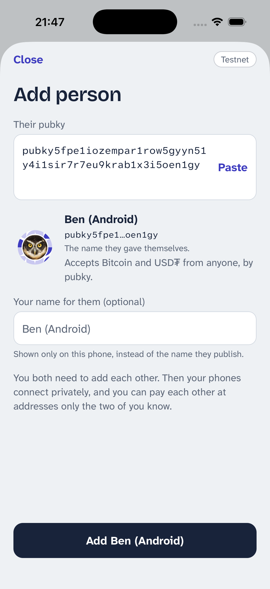 | 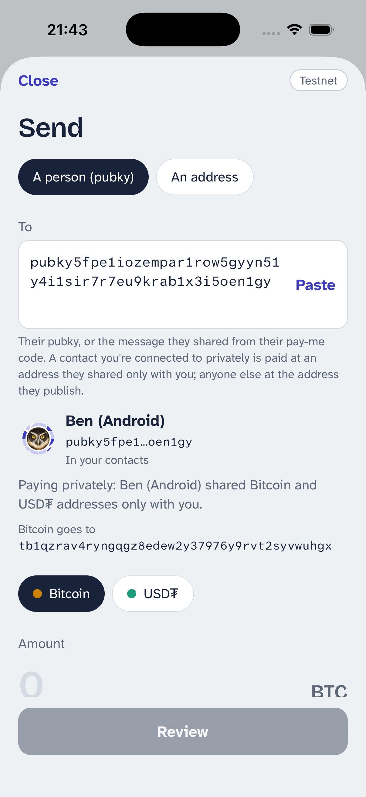 | 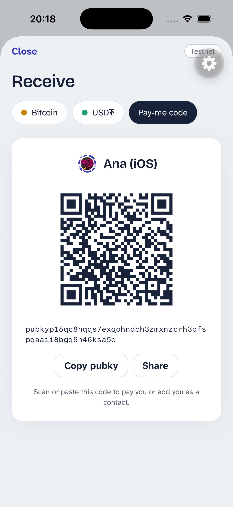 |
| Add a person by pubky | Pay a contact privately | Your pay-me code |
| 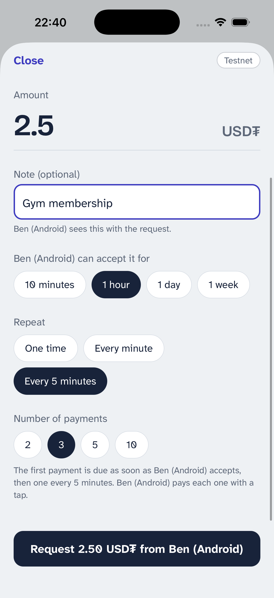 | 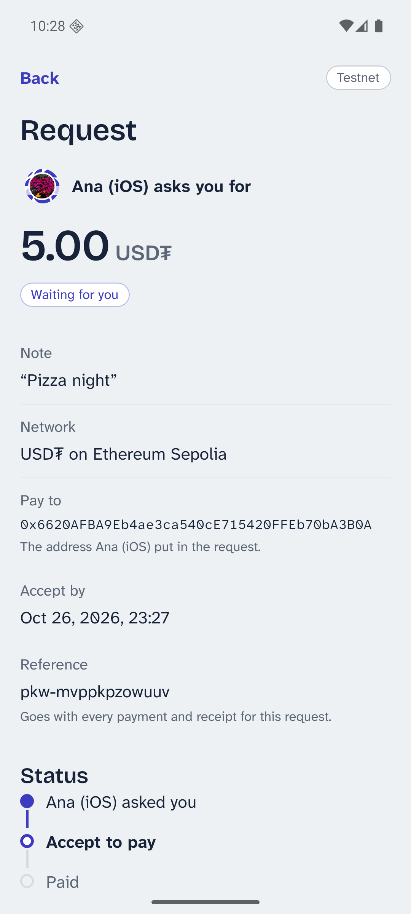 | 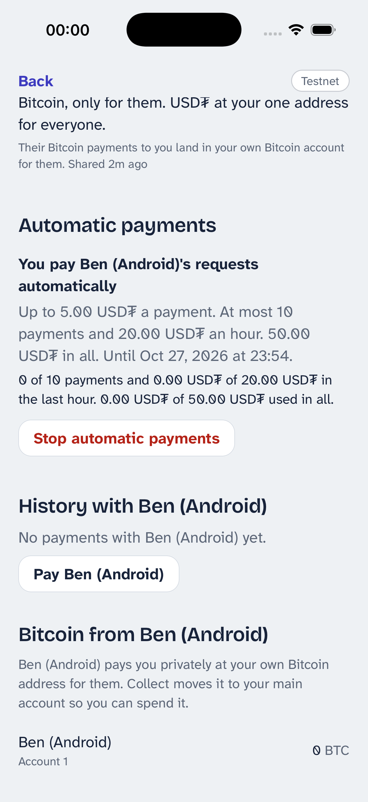 |
| A recurring request | The request timeline | Automatic payments |
| 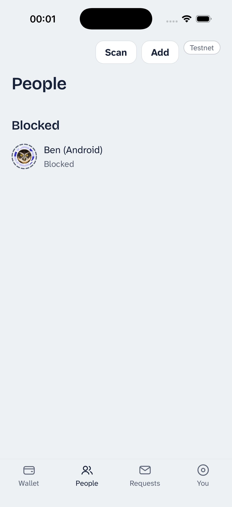 | 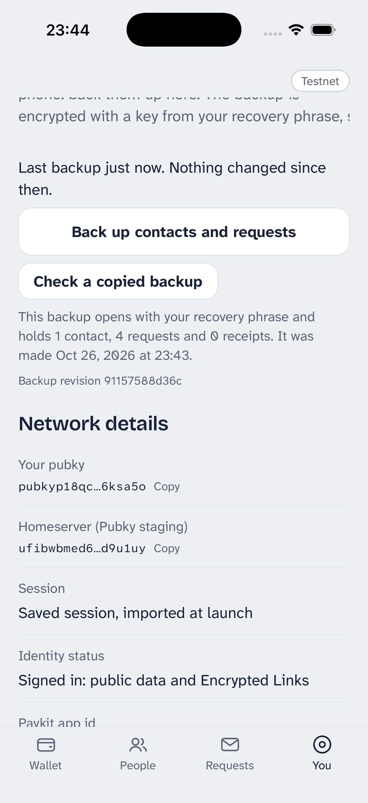 | 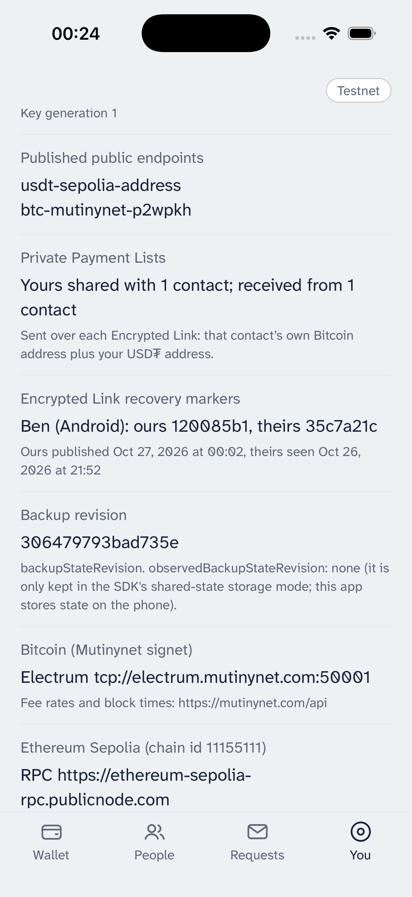 |
| Blocked | Backup checked | Network details |

More, per phase and platform, in [`docs/screenshots/`](docs/screenshots/).

## Run it

You need Node 24, Xcode with an iOS 26 simulator, JDK 17 and the Android SDK
with an arm64 API 36 emulator image.

```sh
scripts/build-paykit.sh          # once: builds vendor/synonymdev-react-native-paykit.tgz
npm install                      # postinstall patches Paykit and builds the WDK worklet
node scripts/demo-env.mjs        # optional: dev prefill from the git-ignored .env.demo
npx expo start --dev-client      # one Metro server for both platforms
```

Native builds (only after native dependencies change). On a 16 GB Mac run
one build at a time: no Android emulator during the Xcode build, no iOS
simulator during the Gradle build.

```sh
# iOS
npx expo prebuild --platform ios --clean
npx expo run:ios --device "<simulator name or UDID>" --no-bundler

# Android (shut the iOS simulator down first)
npx expo prebuild --platform android --clean
(cd android && JAVA_HOME=/opt/homebrew/opt/openjdk@17 ./gradlew assembleDebug && ./gradlew --stop)
adb install -r android/app/build/outputs/apk/debug/app-debug.apk
adb reverse tcp:8081 tcp:8081
```

### Release builds

For a demo, run release builds: the JavaScript is bundled into the app,
there is no dev-tools button and no Metro. Both install over the dev
client and keep its data (same bundle id, and on Android the same debug
signing key that Expo's template uses for release too). `demo.local.ts`
is left out of release bundles, so a release build starts from the saved
identity; a fresh install needs onboarding with a typed phrase.

```sh
# iOS (Android emulator shut down first)
npx expo prebuild --platform ios --clean
npx expo run:ios --configuration Release --device "<simulator name or UDID>" --no-bundler

# Android (iOS simulator shut down first)
npx expo prebuild --platform android --clean
(cd android && JAVA_HOME=/opt/homebrew/opt/openjdk@17 ./gradlew assembleRelease && ./gradlew --stop)
adb install -r android/app/build/outputs/apk/release/app-release.apk
```

Never install a release build signed with another key over the dev
client: Android refuses the update, and uninstalling first deletes the
wallet's data.

Open the dev client on `http://localhost:8081`. **Never reload with Cmd-R or
the dev menu once Paykit has loaded**: relaunch the app cold instead.

```sh
URL='exp+paykit-wdk-wallet://expo-development-client/?url=http%3A%2F%2Flocalhost%3A8081'
xcrun simctl terminate booted com.jasonvdb.paykitwdkwallet && xcrun simctl openurl booted "$URL"
adb shell am force-stop com.jasonvdb.paykitwdkwallet && \
  adb shell am start -a android.intent.action.VIEW -d "$URL" com.jasonvdb.paykitwdkwallet
```

After editing `wdk.config.js`, run `npm run wdk-bundle` and relaunch cold.
The bundle is JavaScript loaded through Metro, so no native rebuild is
needed.

### First launch

Onboarding: **Get started**, then **Restore** (dev builds restore the demo
phrase from `.env.demo` without showing it on screen), **Sign in**,
optionally a name and photo, then **Go to wallet**. Later launches import
the saved session and go straight to the tabs.

A restored wallet always signs in. Only a wallet created on the device (or
one you mark as "This phrase has no identity yet") signs up with an invite
code. The app never falls back from a failed sign-in to sign-up, because
the SDK reports every sign-in failure the same way and a code works only
once.

On iOS, Keychain items survive an uninstall: after a reinstall the WDK
seed, the Pubky session secret and the storage key are still there, and
onboarding offers to continue with that wallet.

Add the other phone as a contact from People > Add, or with a deep link:

```sh
xcrun simctl openurl booted "paykitwdk://contact?pubky=<their pubky>"
adb shell am start -a android.intent.action.VIEW -d "paykitwdk://contact?pubky=<their pubky>"
```

Add person shows who the key belongs to before saving. Both phones must
add each other; the seal ring closes when the private link is ready, and
each phone then shares a Private Payment List with the other (the Person
page shows both directions). Removing a contact withdraws your list and
ends the link; adding each other again forms a new one. You > Sync status
shows the sync loop and its event log, and You > Network details counts the
lists shared each way.

Simulators cannot scan each other's QR codes, so the wallet screens also
open from links:

```sh
xcrun simctl openurl booted "paykitwdk://receive?asset=usdt"
xcrun simctl openurl booted "paykitwdk://receive?code=pubky"           # your pay-me code
xcrun simctl openurl booted "paykitwdk://send?to=<address>&asset=btc"   # fills the form; nothing is sent
xcrun simctl openurl booted "paykitwdk://send?to=<pubky>&asset=usdt"    # pay a person by their public endpoints
xcrun simctl openurl booted "paykitwdk://profile"                      # edit your name and photo
xcrun simctl openurl booted "paykitwdk://scan"                         # scan a code (camera, photo or paste)
xcrun simctl openurl booted "paykitwdk://you"                          # also wallet, people, requests
xcrun simctl openurl booted "paykitwdk://request-money?pubky=<pubky>"  # ask a contact for money
xcrun simctl openurl booted "paykitwdk://request?counterparty=<pubky>&requestId=<id>"  # one request
xcrun simctl openurl booted "paykitwdk://person?pubky=<pubky>"         # a contact's Person page
xcrun simctl openurl booted "paykitwdk://automatic-payments?pubky=<pubky>"  # offer them automatic payments
```

To test the scanner on a simulator, put a screenshot of the other phone's
pay-me code into the photo library and use "Choose a photo of a code":

```sh
xcrun simctl addmedia booted pay-me-code.png
adb push pay-me-code.png /sdcard/Pictures/ && \
  adb shell am broadcast -a android.intent.action.MEDIA_SCANNER_SCAN_FILE -d file:///sdcard/Pictures/pay-me-code.png
```

Public endpoints (You > What you publish) let anyone pay you by your
pubky; switching an asset off removes its endpoint from your homeserver,
and payers are told you don't accept it. Contacts get private addresses
either way.

`.env.demo` (git-ignored, mode 600) can hold `IOS_MNEMONIC`, `ANDROID_MNEMONIC`,
one single-use staging signup code per platform, and the two public keys.
`node scripts/demo-env.mjs --generate-missing` creates missing mnemonics.

### Funding the demo

The demo wallets start empty. Everything below runs on the Mac, reads
`.env.demo`, and never prints a phrase or a token. The iOS demo wallet is
the treasury: its Ethereum account pays for the Sepolia scripts.

```sh
node scripts/fund-status.mjs                 # both wallets: BTC (Mutinynet), ETH and USD₮ (Sepolia)
node scripts/fund-status.mjs --contacts 3    # plus BTC contact accounts 1..3
node scripts/fund-eth.mjs android 0.001      # Sepolia ETH (gas) from the treasury to Android
node scripts/fund-usdt.mjs android 1000      # mint Aave test USD₮ (treasury pays gas)
node scripts/fund-btc.mjs --login            # once a day: GitHub device login for the Mutinynet faucet
node scripts/fund-btc.mjs ios 100000         # Mutinynet sats from the faucet API
```

One-time human steps:

1. **Sepolia ETH for the treasury.** Send about 0.05 Sepolia ETH to the iOS
   wallet's Ethereum address (`node scripts/fund-status.mjs` prints it) from
   a public faucet, such as Google Cloud's Web3 faucet or the pk910 PoW
   faucet. After that, `fund-eth` and `fund-usdt` (and the in-app "Get test
   USD₮" button) need no human.
2. **Mutinynet faucet token.** `node scripts/fund-btc.mjs --login` prints a
   GitHub device code: open <https://github.com/login/device>, enter it, and
   approve the Mutinynet faucet app. The script exchanges the GitHub token
   for the faucet's 24-hour token and saves it as `MUTINYNET_FAUCET_TOKEN`
   in `.env.demo`. The faucet gives at most 1,000,000 sats per GitHub user
   and IP per day. The GitHub app asks only for read-only access to your
   email addresses. If the login fails, use the faucet's own CLI (`cargo install mutinynet-cli`,
   `mutinynet-cli login`) and put the token it stores in
   `~/.mutinynet/token` into `.env.demo` as `MUTINYNET_FAUCET_TOKEN=…`.
   Background: [`docs/research/04-testnet-funding.md`](docs/research/04-testnet-funding.md).

In the app, You > Test funds has "Get test USD₮" (disabled, with the reason,
while the wallet has no ETH for gas) and links to the faucets.

### Checks

```sh
npm run typecheck
npm run lint
npm test
```

Screenshots of each phase on both platforms are in
[`docs/screenshots/`](docs/screenshots/) (`phase1/` to `phase6/`); the Phase 0 spike
screenshots are in [`docs/spike/`](docs/spike/).

Before taking screenshots, hide the dev client's floating tools button so
it does not cover the Testnet chip (it is a dev-build setting, stored per
install; quit the app first, then relaunch it cold):

```sh
# iOS simulator
xcrun simctl spawn <udid> defaults write com.jasonvdb.paykitwdkwallet EXDevMenuShowFloatingActionButton -bool false
# Android emulator: add <boolean name="showFab" value="false" /> to
# shared_prefs/expo.modules.devmenu.sharedpreferences.xml (adb shell run-as com.jasonvdb.paykitwdkwallet)
```

Never capture a screen that shows the recovery phrase.

## Paykit package

Paykit's React Native bindings come from the unmerged
[paykit-rs PR #204](https://github.com/pubky/paykit-rs/pull/204). They are not
on npm yet, so `scripts/build-paykit.sh` builds them from a pinned commit and
packs `vendor/synonymdev-react-native-paykit.tgz`.
